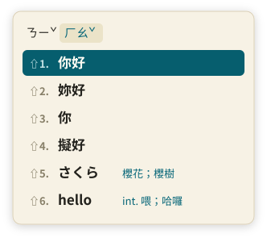
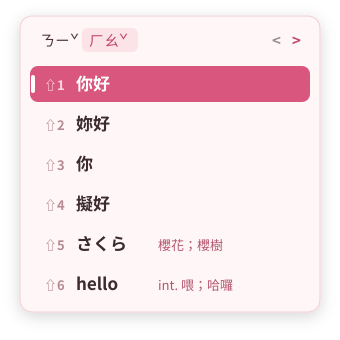
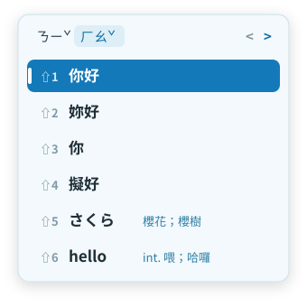
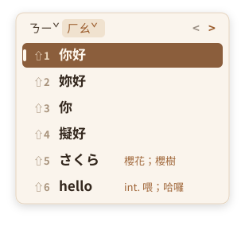
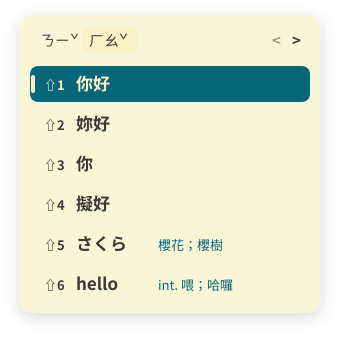
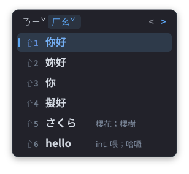
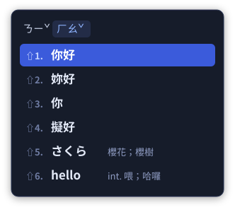
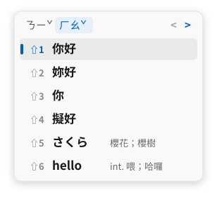

# 注音Na+ —— RIME 注音輸入法設定

一套開箱即用的 [RIME](https://rime.im) 注音輸入法設定，Windows（小狼毫 Weasel）與 macOS（鼠鬚管 Squirrel）共用同一份。

- **整句連打**：內建語言模型，長句選字更準
- **`Shift+1`～`6` 選字**：數字鍵留給注音，選字不必移動手
- **一個方案打多國語言**：注音之外，用前綴直接打英文、日文、韓文、拉丁、希臘、俄文
- **單按右 Shift 換語言**：注音 → 日文 → 韓文 → 英文，像系統內建輸入法一樣按一下就換
- **候選釋義**：日文／英文候選旁邊直接顯示中、英、日文解釋
- **`'/` 多功能選單**：日期時間、計算機、Unicode、UUID、時間戳、色碼轉換…
- **emoji 候選**、自訂短語（打 `email` 出信箱）、九套配色主題

## 安裝

一行指令。會自動備份你原本的 RIME 設定、保留打字詞頻，然後問你幾個選項。

**Windows**（在 PowerShell 貼上）

```powershell
irm https://raw.githubusercontent.com/NatLee/rime-setup/main/install.ps1 | iex
```

**macOS**（在「終端機」貼上）

```bash
bash -c "$(curl -fsSL https://raw.githubusercontent.com/NatLee/rime-setup/main/install.sh)"
```

需要先有：

| | Windows | macOS |
|---|---|---|
| 輸入法本體 | [小狼毫](https://rime.im/download/)（建議 0.17 以上，主題用到的圓角／陰影／深色模式是新版功能） | [鼠鬚管](https://rime.im/download/) 新版（語言模型要用內建的 octagram 外掛） |
| git | [Git for Windows](https://git-scm.com/download/win) | `xcode-select --install` |

缺的話腳本會提示；電腦上有 `winget`／Homebrew 時會問你要不要順便裝。
下載量約 100 MB，第一次部署要編譯詞典，約 2～5 分鐘。

macOS 裝完還有兩個系統設定要手動改（腳本改不到）：

1. **系統設定 → 鍵盤 → 輸入方式**：關閉「使用大寫鎖定鍵切換輸入法」（否則 Caps Lock 被系統攔走，中英切換失效）
2. **系統設定 → 鍵盤**：開啟「將 F1、F2 等按鍵作為標準功能鍵」（否則 `F4` 叫不出方案選單；不想開就改用 `Ctrl+` `` ` ``）

### 安裝時可以選什麼

| 選項 | 可選的值 | 預設 |
|---|---|---|
| 主題 `theme` | `matcha`／`light`／`fluent`／`sakura`／`ocean`／`latte`／`dark`／`midnight`／`classic`，長相見下方[主題](#主題) | `matcha` |
| 系統深色模式 `dark` | `auto` 系統切到深色模式時自動換成深色主題／`off` 永遠用上面選的主題 | `auto` |
| 候選排列 `layout` | `vertical` 直排／`horizontal` 橫排 | `vertical` |
| 候選字級 `size` | `small`／`medium`／`large` | `medium` |
| 候選字型 `font` | `huninn` 粉圓體（[jf open 粉圓](https://github.com/justfont/open-huninn-font)，沒裝會自動下載安裝，約 5 MB）／`system` 系統內建（正黑體、蘋方） | `huninn` |
| 候選附帶 emoji `emoji` | `on`／`off` | `on` |
| 方案選單裡的語言 `langs` | `ja` 日文、`ko` 韓文、`en` 英文、`extra`（注音文、全形、符號…）任意組合；`none` 只留注音 | 全部 |
| 釋義語言 `gloss` | `zh`／`en`／`ja` | `zh` |

`langs` 決定的是「方案選單裡有哪些獨立方案」；主方案裡用前綴打日文／英文的功能不受影響。

### 主題

<table>
<tr>
<td align="center"><br><code>matcha</code> 抹茶奶油（預設）</td>
<td align="center"><br><code>light</code> 明亮</td>
<td align="center"><br><code>sakura</code> 櫻花</td>
</tr>
<tr>
<td align="center"><br><code>ocean</code> 海洋</td>
<td align="center"><br><code>latte</code> 拿鐵</td>
<td align="center"><br><code>classic</code> 經典</td>
</tr>
<tr>
<td align="center"><br><code>dark</code> 深色</td>
<td align="center"><br><code>midnight</code> 午夜</td>
<td align="center"><br><code>fluent</code> 低調</td>
</tr>
</table>

預覽圖是照配色畫出來的示意圖（`pwsh tools\theme-preview.ps1` 產生），不是螢幕截圖；實際的字型與間距以輸入法為準
（預設的候選字型是粉圓體，預覽圖裡用的是你瀏覽器的字型）。
選了淺色主題又開著「系統深色模式：跟隨」時，系統切到深色會自動換成 Nat Dark。

### 重新選擇、重新安裝

**在輸入法裡打 `'/setup` 再按空白鍵**（或 `'/` → 設定 → 選項），會開一個視窗列出目前全部的設定：

```
目前的設定
  1) 主題　　　　　Nat Matcha 抹茶奶油色
  2) 系統深色模式　跟隨系統
  3) 候選排列　　　直排
  4) 候選字級　　　中
  5) 候選附 emoji　開
  6) 選單裡的語言　日文、韓文、英文、其他
  7) 釋義語言　　　中文
  8) 候選字型　　　粉圓體
  輸入編號 1-8 修改那一項；直接按 Enter 套用
```

想改哪一項就輸入它的編號，都不改直接按 Enter。套用後自動重新部署。

再跑一次安裝指令也是同一個畫面，差別是它會先更新到最新版。裝過的機器不會再備份一次。

不想連網也可以跑本機那一份：

- Windows：雙擊 RIME 使用者資料夾（預設 `%APPDATA%\Rime`）裡的 `na-setup.cmd`
- macOS：`bash ~/.na-plus/install.sh --local`

不想被問（固定選項、自動化）：

```powershell
# Windows：先設環境變數，或直接帶參數
$env:NA_THEME='dark'; $env:NA_EMOJI='off'; $env:NA_YES='1'
irm https://raw.githubusercontent.com/NatLee/rime-setup/main/install.ps1 | iex

& ([scriptblock]::Create((irm https://raw.githubusercontent.com/NatLee/rime-setup/main/install.ps1))) -Theme dark -Langs ja,en -Yes
```

```bash
# macOS
NA_THEME=dark NA_EMOJI=off NA_YES=1 bash -c "$(curl -fsSL https://raw.githubusercontent.com/NatLee/rime-setup/main/install.sh)"

bash ~/.na-plus/install.sh --local --theme dark --langs ja,en --yes
```

環境變數：`NA_THEME` `NA_DARK` `NA_LAYOUT` `NA_SIZE` `NA_FONT` `NA_EMOJI` `NA_LANGS` `NA_GLOSS`，`NA_YES=1`＝不詢問（沒指定的沿用上次）。

### 更新

輸入法裡打 `'/git` 再按空白鍵。會拉取最新設定並套用，有檔案變動才重新部署；沒有更新時幾秒就結束、不打斷輸入法。

### 手動安裝（不用安裝腳本）

RIME 只認使用者資料夾**根目錄**的方案與設定檔，而這個 repo 為了好維護把檔案按功能分在 `rime/` 的子資料夾裡，
所以手動安裝要做的事就是「攤平複製」：

1. 取得這個 repo：`git clone https://github.com/NatLee/rime-setup.git`（或下載 ZIP 解壓）
2. 找到 RIME 使用者資料夾：Windows 預設 `%APPDATA%\Rime`（工作列圖示右鍵 →「用戶文件夾」）、macOS `~/Library/Rime`。
   **先把它整個備份起來**，然後關掉輸入法服務（Windows：工作列圖示右鍵 →「退出算法服務」）
3. 複製檔案：
   - `rime/lua/` 與 `rime/opencc/` → 整個資料夾複製過去（變成 `<使用者資料夾>/lua/`、`<使用者資料夾>/opencc/`）
   - `rime/` 底下**其他每個資料夾裡的檔案** → 全部直接放到使用者資料夾根目錄（不要帶子資料夾）

   不想手動搬可以用 repo 內附的腳本，只複製、不動輸入法：
   `powershell -ExecutionPolicy Bypass -File scripts\rime-apply.ps1`（Windows）／`bash scripts/rime-apply.sh`（macOS）
4. （選用）調整選項：在使用者資料夾新增 `na_options.custom.yaml`，只寫想改的鍵，可用的鍵與值見 [rime/core/na_options.yaml](rime/core/na_options.yaml)：

   ```yaml
   patch:
     theme: NatLight        # NatMatcha／NatLight／NatFluent／NatSakura／NatOcean／NatLatte／NatDark／NatMidnight／NatLee
     theme_dark: NatDark    # 系統深色模式時用的主題
     font_point: 20         # 候選字級（macOS 是 mac_font_point）
     emoji: 0               # 1 開／0 關
   ```
5. （選用）把 `bopomo_onionplus_phrase.sample.txt` 複製成 `bopomo_onionplus_phrase.txt`，寫入自己的短語
6. **重新部署**：Windows 開始功能表 →「小狼毫輸入法」→「重新部署」（或工作列圖示右鍵）；macOS 輸入法選單 →「重新部署」

手動安裝沒有 `'/git` 更新功能（它靠安裝腳本產生的啟動器）；之後要更新就 `git pull` 再做一次步驟 3 與 6。

### 移除／還原

第一次安裝時，原本的設定被整個搬到旁邊的 `<使用者資料夾>.backup.<時間>`。要還原：
關掉輸入法服務、刪掉現在的使用者資料夾、把備份資料夾改回原名，再重新部署。
設定 repo 的本機副本在 `%USERPROFILE%\.na-plus`（Windows）／`~/.na-plus`（macOS），不用了可以直接刪。

## 檔案放在哪

安裝後有兩個地方：

| 位置 | 內容 |
|---|---|
| `~/.na-plus`（Windows：`%USERPROFILE%\.na-plus`） | 這個 repo 的本機副本。更新靠它，請不要刪 |
| RIME 使用者資料夾（Windows 預設 `%APPDATA%\Rime`、macOS `~/Library/Rime`） | 輸入法實際讀的檔案（由腳本從上面那份攤平複製過來）＋你自己的資料 |

使用者資料夾裡這些是**你自己的**，只留在你的電腦上，不在 repo 裡、更新時也不會被覆蓋：

| 檔案 | 內容 |
|---|---|
| `*.userdb/`、`sync/` | 打字詞頻（你的用字習慣） |
| `bopomo_onionplus_phrase.txt` | 自訂短語。輸入法裡打 `'/phrase` 開啟編輯，改完重新部署 |
| `na_options.custom.yaml` | 安裝時選的選項 |
| `installation.yaml`、`user.yaml`、`build/` | RIME 自己產生的機器狀態與編譯結果 |

其餘從 repo 複製過來的檔案（方案、詞典、lua、`*.custom.yaml`）**每次更新都會被 repo 的版本蓋掉**，
要長期修改請改 repo（fork）裡的來源。

## 常用操作

完整說明在速查表：輸入法裡打 `'/h` 再按空白鍵（[cheatsheet.html](rime/core/cheatsheet.html)）。

| 功能 | 操作 |
|---|---|
| 選字 | `Shift+1`～`Shift+6`（候選標籤 ⇧1～⇧6） |
| 中英切換 | `Shift` 或 `Caps Lock` |
| 換下一個語言 | 單按**右 Shift**（注音 → 日文 → 韓文 → 英文 → 回到注音；正在組字時不切） |
| 方案選單（切語言、開關 emoji／簡體／釋義語言…） | `Ctrl+` `` ` `` 或 `F4` |
| 直接切方案 | `Ctrl+Shift+F1~F4`（Windows）／`Ctrl+Opt+1~4`（macOS） |
| 功能總選單 | 單獨打 `'/` —— 日期、計算機、開發工具、編碼…都有入口，不必背代碼 |
| 計算機 | `'/123+45*2` |
| emoji | `` ` `` 開頭 |
| 自訂短語 | 打你設定的編碼（例如 `email`）後按 `⇧1` |
| 速查表／選項／更新／編輯短語 | `'/h`／`'/setup`／`'/git`／`'/phrase` |

## Repo 結構

```
install.ps1 / install.sh    一行安裝的入口（Windows／macOS）
rime/                       會被裝進 RIME 使用者資料夾的全部內容，按功能分類
├─ core/                    全域設定：快捷鍵與方案清單、rime.lua、安裝選項預設值、速查表
├─ theme/                   候選窗配色與字型（小狼毫／鼠鬚管）
├─ bopomofo/                注音主方案、中文詞庫、語言模型、注音文、符號、倉頡反查
├─ japanese/                日文方案、詞庫、三語釋義詞典
├─ korean/                  韓文方案與詞庫
├─ english/                 英文方案與詞庫（含附釋義版）
├─ european/                拉丁／希臘／俄文
├─ fullshape/               全形
├─ lua/                     lua 外掛（'/ 多功能選單、選字鍵、釋義…）
└─ opencc/                  字集過濾與 emoji／符號標註對照表
scripts/                    套用（攤平複製）、更新、同步
tools/                      沙盒回歸測試、鍵位表產生器（開發用）
docs/                       架構、鍵位總表、踩過的坑
```

`lua/` 和 `opencc/` 安裝時保留資料夾，其他分類裡的檔案都會被攤平到使用者資料夾根目錄
（所以**不同分類之間檔名不能重複**，腳本會檢查）。

## 想自己改

- 要改什麼該動哪個檔：[CLAUDE.md](CLAUDE.md) 的對照表
- 架構：[docs/ARCHITECTURE.md](docs/ARCHITECTURE.md)｜鍵位與代碼總表：[docs/KEYMAP.md](docs/KEYMAP.md)｜踩過的坑：[docs/GOTCHAS.md](docs/GOTCHAS.md)
- 改完先在沙盒跑回歸測試（Windows、需要 PowerShell 7）：`pwsh tools\rime-test.ps1 -Sync -Mode basic`
- 套用到自己這台：`pwsh scripts\rime-update.ps1 -SkipPull`（Windows）／`bash scripts/rime-update.command --skip-pull`（macOS）
- **Fork 之後**想讓安裝指令裝你的版本：把指令裡的網址換成你的 repo，並設 `NA_REPO=https://github.com/<你>/<repo>.git`
  （或直接改 `install.ps1`／`install.sh` 開頭的預設值）
- `scripts/rime-sync.ps1`／`rime-sync.sh` 是給對 origin 有寫入權限的人用的（拉取 → 套用 → commit → push），
  用來在自己的多台電腦之間同步設定；一般使用者用 `'/git` 就夠了

## 來源與致謝

- **洋蔥注音**（[Onion Rime Files](https://github.com/oniondelta/Onion_Rime_Files)，oniondelta）：
  這套設定是從它出發的。`rime/` 底下各語言的方案檔、鍵位設計、碼表與增補詞庫，以及 `rime/lua/` 裡
  多數元件的原始版本都來自它；這裡在其上做了重整、刪減與改寫。
- 輸入法引擎：[RIME／中州韻](https://rime.im)、[librime-lua](https://github.com/hchunhui/librime-lua)
- 語言模型：[rime-octagram-data](https://github.com/lotem/rime-octagram-data)
- 候選字型：[jf open 粉圓](https://github.com/justfont/open-huninn-font)（justfont，SIL Open Font License 1.1）。字型檔不在這個 repo 裡，安裝時從它的官方發佈頁下載
- 日文釋義：[JMdict/EDICT](https://www.edrdg.org/jmdict/j_jmdict.html)（EDRDG，CC BY-SA 4.0）、
  [日本語 WordNet](http://compling.hss.ntu.edu.sg/wnja/)（NICT）、Chinese Wordnet（中央研究院）、
  [Chinese Open Wordnet](http://compling.hss.ntu.edu.sg/cow/)，經 [Open Multilingual Wordnet](https://github.com/omwn/omw-data) 對齊
- 英文釋義：[ECDICT](https://github.com/skywind3000/ECDICT)
- 中文詞庫：[sc-dictionary](https://github.com/samejack/sc-dictionary)（SJ Chou）等，詳見各詞典檔頭

各詞典與資料檔依其原始授權使用，來源與授權聲明保留在各檔案開頭。
